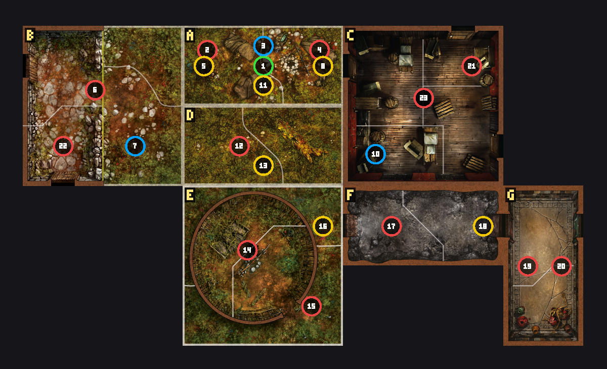

# At the Mountains of Madness

A Mansions of Madness 2nd Edition scenario for [Valkyrie](https://github.com/NPBruce/valkyrie), adapted from H. P. Lovecraft's novella. Antarctica, 1931: the relief party of the Miskatonic University Expedition flies to Lake's silent camp, crosses the range into a city older than mankind, and runs from what its builders feared.

Built with [ValkyrieMCP](https://github.com/thijs-hakkenberg/ValkyrieMCP), and its poster scenario: every puzzle type, multi-phase custom monsters, event loops, variable-driven systems and custom ComfyUI artwork.

| | |
|---|---|
| Players | 2–4 investigators |
| Length | ~150 minutes, three acts |
| Difficulty | 0.6 |
| Requires | Base game, Path of the Serpent, Recurring Nightmares |

## Status

In development. See the [storybook](docs/storybook.md) for the design.

- [x] Storybook
- [x] Systems: exposure, petrol, understanding, the Tekeli-li clock, Danforth, the gale deck
- [x] Prologue and Act I, Lake's Camp (preview build ends at takeoff)
- [ ] Interlude, Over the Range
- [ ] Act II, The City of the Old Ones
- [ ] Act III, Tekeli-li! and the endings



## Install

1. Download `AtTheMountainsOfMadness.valkyrie` from the releases (or `dist/`).
2. Copy it into Valkyrie's download folder, or open the source folder `AtTheMountainsOfMadness/` in the Valkyrie editor (`~/.config/Valkyrie/MoM/Editor/` on macOS/Linux, `%APPDATA%\Valkyrie\MoM\Editor\` on Windows).

## Building

The scenario is generated by a script that drives the [ValkyrieMCP](https://github.com/thijs-hakkenberg/ValkyrieMCP) library, so it can be rebuilt, rebalanced and diffed:

```bash
npm install
npm run build      # writes AtTheMountainsOfMadness/ and validates it
npm run package    # also builds dist/AtTheMountainsOfMadness.valkyrie
```

Artwork is generated separately with ComfyUI (FLUX.2 [klein] 4B) through the MCP tool `generate_artwork`; `art/prompts.json` records every prompt and seed.

## Repository layout

| Path | Contents |
|---|---|
| `docs/storybook.md` | Tone, plot devices and mechanics per act |
| `build/` | The build script: one module per act, plus the shared systems |
| `AtTheMountainsOfMadness/` | Valkyrie scenario source (INI, localization, images) |
| `art/prompts.json` | The prompt, seed and preset for every generated image |
| `dist/` | Built `.valkyrie` package |

The novella *At the Mountains of Madness* (1936) is in the public domain.
